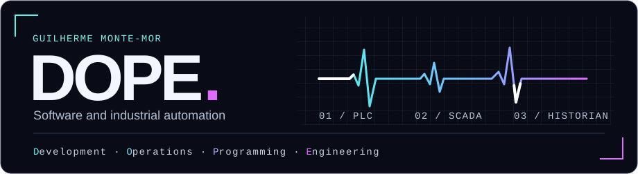

I build SCADA screens and configure alarms for the people who operate industrial equipment. When a team needs to investigate an incident, I configure a historian or SQL database to collect signals from the PLC. That way, operators can go back to the time of the alarm and see how the signal changed before and after it.

### What you’ll find here.

I write Python tools that turn long recordings into timestamped transcripts so I can find the moment someone mentions a particular term. I also automate parts of video editing, like checking a batch of clips for an on-screen username before drafting titles and descriptions. On the web side, I build database-backed apps for tasks like keeping a product catalog up to date.

DOPE grew out of *dopxmor*, the nickname I used in games as a kid.

[LinkedIn](https://www.linkedin.com/in/guilherme-monte-mor/) · [Email](mailto:guimontemor777@gmail.com)
